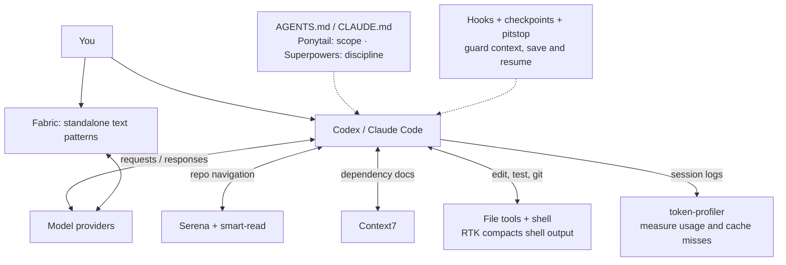

# Coding Agent Toolchain: Delivery and Efficiency

## 1. Purpose

| Tool | Layer | Question | Effect |
|---|---|---|---|
| **Ponytail** | Solution policy | How much should we build? | Smaller implementations; fewer abstractions/dependencies/files |
| **Serena** | Internal code intelligence | How does this repo work? | Symbol-level retrieval, reference tracing, semantic editing |
| **Context7** | External dependency knowledge | How does this library/API work in this version? | Current library/API docs and examples |
| **RTK** | Shell execution | How much terminal output does the model need? | Rewrites supported commands to compact equivalents |
| **Superpowers** | Implementation discipline | How do we implement and verify the change? | Conditional TDD, debugging, verification, and review skills |

The tools act at different stages; their savings overlap, so percentages are **never added**.

This repo installs the stack for personal and work profiles of Codex and Claude Code: Serena and Context7 as user-level MCP servers, Ponytail as a native plugin, RTK via Codex and Claude hooks. Both clients talk to Anthropic and OpenAI directly. `token-profiler` reads local Codex and Claude sessions per profile.

Two local safeguards complement them, neither runs `/compact` automatically:

- Codex: a hook warning when a large same-thread context nears a quota stop;
- Claude Code: the same warning in its native, token-free status line, which also shows prompt-cache warmth, hit ratio, misses and prefix size.
  Codex 0.162.1 has no equivalent: its status line accepts only built-in items, none for cache stats.

## 2. Mental model



Solid arrows show the working loop; dotted arrows show guidance and session support. Tools are chosen as needed. `ai-install.sh` wires the stack into personal and work profiles; `smoke-test.sh` checks the setup.

## 3. Ponytail

Implementation-policy plugin: stop at the earliest rung that works — (1) needed at all? (2) already in the codebase? (3) stdlib? (4) native platform? (5) installed dependency? (6) one line? (7) minimum new code. Minimalism comes **after understanding the real flow**; trust-boundary validation, data-loss prevention, security, accessibility and explicit requirements are never cut.

The installer keeps Ponytail installed but disables it by default in both clients. Enable it before a new session when requested; the commands below describe installation, not the managed startup default.

```bash
codex plugin marketplace add DietrichGebert/ponytail && codex plugin add ponytail@ponytail
claude plugin marketplace add DietrichGebert/ponytail && claude plugin install ponytail@ponytail
```

- Codex: skills + lifecycle hooks; invoke with `@ponytail`, `@ponytail-review`. A root `AGENTS.md` can carry the core policy where the plugin isn't active.
- Claude: `/ponytail` commands. This repo installs once for `~/.claude` and once with `CLAUDE_CONFIG_DIR=~/.claude-work`.

**Reduces:** generated LOC, new abstractions, unnecessary dependencies, files changed, and code later read/tested/diffed/reviewed/sent back through context. The project's own benchmark reports ~54% less LOC, 22% fewer tokens, 20% lower cost, 27% less elapsed time — project-reported, not universal; token savings are a side effect and vary by model and task.

**Risk:** over-minimization that skips understanding, validation, security or required edge cases (the rules guard against this).

## 4. Serena

Semantic code-intelligence MCP server exposing IDE-like, language-server-backed symbol operations: `get_symbols_overview`, `find_symbol`, `find_referencing_symbols`, `replace_symbol_body`. It replaces *grep huge repo → read whole files → infer relationships* with *find symbol → inspect structure → trace references → read only needed bodies → edit at the symbol boundary*.

Setup (`configure_agent_mcps` in `llm/ai-install.sh`, all four profiles):

```bash
codex mcp add serena -- serena start-mcp-server --context=codex --project-from-cwd --open-web-dashboard false
claude mcp add --scope user serena -- serena start-mcp-server --context=claude-code --project-from-cwd --open-web-dashboard false
```

Upstream's `serena setup codex` writes the equivalent Codex entry. Verify with `/mcp`. Codex App sessions not started in the project dir: say "Activate the current dir as project using serena." Serena activation and reminder hooks are removed from both clients: configuration-only tasks should not load the manual or activate a language server. For symbol work, read the manual once and pass its session ID to activation; session-end cleanup remains enabled.

**Retrieval order:** activate project if needed → overview → target symbol → references/callers when siblings may be affected → bodies only when needed → smallest correct edit. Use raw file/search tools for non-code files, generated artifacts, exact-text search, unsupported languages, and tiny known files.

**Reduces:** full-file reads, broad grep output, context spent discovering structure, edits in the wrong layer, time finding callers. Value grows with repo size and reference complexity.

**Costs:** LSP startup/indexing, extra MCP process/state, per-language LSP limits, duplication if more than one Serena instance is configured.

### smart-read

Serena needs a symbol name and a supported language. `smart-read` (`llm/smart-read/`, installed with `uv tool`) covers what is left: finding code by behavior ("where are spend retries configured") and reading part of a large SQL, Terraform, YAML or Markdown file. File reads were 30–55% of re-read input in the largest Claude sessions, mostly whole files printed with `cat`. It is a CLI, so both clients use it through the shell with no extra tool schemas.

- `search "<question>" [--path P] [-k N]` inside the target Git repository:
  - Fuses BM25, trigram, and existing local code embeddings (`jina-embeddings-v2-base-code`); pending chunks use lexical retrieval. Search never creates embeddings or starts workers. Agents default to `--lexical` to avoid loading models.
  - It prints the best line ranges with line numbers.
- `outline FILE` lists symbols with line ranges.
- One SQLite index per repository lives under `~/.cache/smart-read` and refreshes incrementally. If sandbox permissions block cache writes, `search --lexical` uses an in-memory index for that call, without escalation or embeddings. `index` embeds pending chunks in the foreground, with batch progress and Ctrl-C cancellation, only on explicit user request. An OS lock prevents overlapping commands in that repository.
- Model choice and retrieval quality are in `llm/smart-read/README.md`.
- `read_hint.py`, a PreToolUse hook for Claude Read/Bash and Codex Bash, adds a short note pointing at `smart-read` before a whole-file read of 80 or more lines, including `rtk cat`, `rtk proxy cat` and large skill files; at 300 or more it denies the first such read of that file in a session, and repeating the call goes through. Ranged and piped reads pass through.

## 5. Context7

Current docs/examples for third-party libraries and APIs — external knowledge, not repo navigation. Serena: "how does OUR code work?" (where is our FastAPI app initialized?). Context7: "how does THIS dependency work?" (how does `StreamingResponse` behave in the current FastAPI?).

Install via `npx ctx7 setup --codex`, or `codex plugin marketplace add upstash/context7 && codex plugin add context7@context7-marketplace`. `AGENTS.md` should say only *when* to use it, not how to bootstrap it.

**Use when** the work depends on third-party APIs, version-specific behavior, recently changed frameworks, SDK/provider config, or unfamiliar dependencies already in the repo. Not on every task.

**Version guard:** in Claude Code and Codex, `llm/context7_version_guard.py` (`PreToolUse`) denies `query-docs` when the project's `.venv`, `venv`, `uv.lock`, `poetry.lock`, `requirements*.txt` or `node_modules` pins the library and neither `libraryId` nor the query names that version. Upgrade research can use an explicit versioned library ID or `target version: X.Y.Z` in the query. This checks the request; the agent must still verify the returned source covers the target.

**Decision rule:** about this repo → Serena; about an external library/API → Context7; stable, known language/runtime behavior → neither.

**Interactions:**
- Ponytail asks "can an installed dependency do this?"; Context7 answers "yes, use library X's API", so the agent reuses it instead of building or adding something.
- With Serena, e.g.: Serena finds where the project uses SQLAlchemy → Context7 gets the relevant API behavior → agent applies it to the existing pattern.

**Reduces:** stale API assumptions, hallucinated methods/options, unnecessary web searches, custom code for features an installed library already has, version-mismatch rework. **Cost:** docs are context; use conditionally, not reflexively.

## 6. RTK

CLI proxy/filter that shrinks shell output **before it becomes model context**. Example: Codex wants `cargo test` → `PreToolUse` hook runs the RTK processor → executes `rtk cargo test` → compact, task-relevant output.

Verified with **Codex CLI 0.162.1 and RTK 0.49.0**: Codex supports `PreToolUse` rewrites for shell and unified-exec calls, matched as `Bash` with `tool_input.command`. RTK's `init --codex` installs `AGENTS.md`/`RTK.md` instructions only; it does not install a Codex hook. This repo's installer separately merges a Bash hook into both Codex profiles and installs `codex_rtk_hook.py`. The adapter uses `rtk hook claude` and adds the `permissionDecision: "allow"` field required by [Codex's hook contract](https://learn.chatgpt.com/docs/hooks#pretooluse). It changes the command, while Codex's normal permission and sandbox checks still apply.

After installation, restart the shell. Review new or changed Codex hooks in `/hooks` for personal and work CLI sessions. Confirm a plain `git status` tool call executes as `rtk git status` before relying on automatic rewriting. Until then, manually prefix supported commands. `smoke-test.sh` checks configuration and the installed RTK processor's output contract, but cannot establish runtime trust. Force raw output with `RTK_DISABLED=1 <command>` (e.g. `RTK_DISABLED=1 git diff`); already-prefixed and unsupported commands pass through unchanged.

**Impact:** advertised up to ~90% fewer Bash-output bytes for supported workflows — tool output, not total session tokens. Best on tests, builds, git, package managers, repetitive output. **Risk:** filtering can hide details for unusual debugging; rerun that command raw or narrow it.

## 7. Context safeguards


### Same-thread compaction safeguards

Goal: cut the first fresh-token spike after a long quota-reset pause without switching threads, handing off, or giving up warm cache early.

| Agent | Signals | Mechanism | Result |
|---|---|---|---|
| Codex | Rollout `token_count`: input context, active primary/secondary quota windows | `UserPromptSubmit` hook; warns once while the condition holds | Recommend `/compact`, resume same thread |
| Claude Code | Status-line JSON: context tokens/%, 5-hour and 7-day usage, cache warmth, hit ratio, misses, prefix size | Token-free persistent status line | Recommend `/compact`, continue same conversation |

Threshold: context ≥ 120,000 input tokens **and** either active quota window ≥ 85% used. Code: `llm/codex/codex_compact_warning.py`, `llm/codex/codex-hooks.json`, `llm/claude/claude_compact_statusline.py`.

Claude's native auto-compaction stays on; `CLAUDE_AUTOCOMPACT_PCT_OVERRIDE` is not set, since a lower fixed threshold isn't quota-aware and could rewrite a still-warm prefix early. No automatic external `/compact` for either agent: a visible recommendation beats injecting commands into an interactive session without a supported quota-aware trigger.

### Idle compaction

`llm/idle_compact.py` cuts the cost of returning to a large Claude session after its prompt cache expired. On a subscription the cache lives 1 hour (5 minutes on an API key or in usage overage); the next call rewrites the whole context at 2× input price. Across nine measured sessions these rebuilds were 27% of Claude cost (largest: 6 days, median context 415K, 20 idle rebuilds of ~360K). RTK and Serena shrink tool output and can't touch this. Claude now also has native idle compaction; the measurements describe the earlier sessions, not the savings over that native feature.

Fix: have the model write a checkpoint while the cache is warm; on return, optionally continue from it in a fresh chat. Estimated idle-resume share: 27% → ~7% when the fresh chat is chosen.

Both clients have the model write the checkpoint from the session's full context while the cache is still warm, so it costs a cache read rather than a rewrite. Claude wakes the session in place; Codex, whose background hooks cannot wake an idle session, forks the thread headlessly. Floors are 2× a fresh chat's first call: 85K for Claude (median fresh start 42K) and 45K for Codex (22K); below that a restart saves little. The quota safeguard keeps its own 120K floor. Idle compaction handles ordinary idle gaps; the quota warning handles the pause forced by an exhausted quota.

#### One idle period (Claude)

1. **Reply arrives.** The `Stop` hook starts `arm` in the background (`asyncRewake: true`, `timeout: 4000`). It sleeps until 0.9 of the cache TTL after the last call: 54 min for the 1-hour cache, 4.5 min for the 5-minute one, read from the latest call's `cache_creation`. When the native idle compactor flag (`tengu_sunny_locket`) is `compact`, it waits until 0.93 instead, so a native compaction that does run lands first and cancels the checkpoint. A new message or newer arm token cancels the sleeper.
2. **At the fire time** `arm` writes the digest and cleaned transcript, then exits 2. That wakes the session with the checkpoint request plus the digest. The model writes the checkpoint without tools. The turn reads from cache and renews it, keeping the full session cheap for about one more TTL, and the user sees the checkpoint turn.
3. **Next `Stop`** stores the reply's text blocks (never thinking) as `checkpoint.md`, recording the last prompt it covers.
4. **Session closes first.** The `SessionEnd` hook (`end`, not for `/clear`) stores transcript excerpts when no fresh checkpoint exists, because the sleeper may die with the session.
5. **Return after expiry.** On the 1-hour cache the `UserPromptSubmit` guard blocks the first prompt once, shows rebuild size and checkpoint time, and repeats the prompt. On the 5-minute cache (API key or usage overage) it only shows a non-blocking hint, since short pauses are frequent there. With no fresh checkpoint it suggests `/compact` without blocking.
6. **`/pitstop`** in that session hands its checkpoint off (the guard blocks the prompt), and the next `/clear` loads it through the `SessionStart` `clear` hook; the handoff lasts until used or until the old chat gets a new prompt. `/pitstop` in a new chat runs `idle_compact.py resume`: the newest checkpoint for the project whose chat had no prompt since, in fixed section order, then the digest, repo drift since the checkpoint, the resume protocol, and up to four other valid checkpoints with their goals and the `resume <session>` command to load one instead.

#### Manual checkpoint (both clients)

`/checkpoint` (Claude) or `$checkpoint` (Codex) saves a handoff at a task boundary, while the cache is warm. Use it when the context passes about 250K tokens: replaying this machine's history with a cap at 250K resetting to 40K gives an upper bound of 62% of current Claude cost. The `UserPromptSubmit` guard saves the digest and transcript snapshot and adds the checkpoint request as context, with no size floor. The model writes the checkpoint in that turn, from full context at cache-read price. The next `Stop` stores it and sets the handoff. Claude's `/clear` loads it in the same window. In Codex, open a new chat in the same workspace and run `$pitstop <session>` with the ID printed by the checkpoint request; saving a checkpoint alone does not shrink the old chat.

#### One idle period (Codex)

The `Stop` hook runs `arm --client codex` in the background (`async: true`, `timeout: 11000`). After 27 minutes without new activity (0.9 of the [documented 30-minute minimum cache lifetime](https://developers.openai.com/api/docs/guides/prompt-caching#cache-lifetime) for GPT-5.6 and later) it runs `codex exec fork <session> --ephemeral -m <session model>` with the same checkpoint request. The fork shares the thread's cached prefix (measured: 12,672 of 12,887 prompt tokens read from cache), sees full context, persists nothing, and leaves the open thread untouched. If the fork fails or `codex` is missing, it falls back to transcript excerpts. The `SessionEnd` hook starts a detached local worker to store excerpts when the session closes before that. Only the handoff must finish within Codex's 3-second shutdown limit; the save continues after Codex exits. Worker errors are written to `$XDG_STATE_HOME/idle-compact/sessions/<session>.end.log` (default `~/.local/state/idle-compact/sessions/`).

The guard acts after a 30-minute gap, but the cache often outlives that: across this machine's rollouts, gpt-5.4 and gpt-5.3-codex mostly hit after hours, while gpt-5.5 missed about half the gaps over 75 minutes. `arm` therefore logs each post-gap call's cache hit per model in `codex-cache.json`. Once a model has at least 5 samples with ≥ 80% hits, the guard shows a non-blocking hint instead of blocking. Otherwise it blocks once like Claude's. Codex messages direct the user to a new chat with `$pitstop <session>`; `/clear` is a CLI command, not a documented IDE command, and appeared as ordinary user text in the reviewed QPQ IDE session. Use the IDE's [New Chat command](https://learn.chatgpt.com/docs/ide/commands) or the corresponding client control. The installer adds `llm/codex/pitstop/SKILL.md` to `~/.agents/skills/pitstop/`.

#### Checkpoint content

The model writes Goal, Done, Decisions, Dead ends, Current state, Constraints, Next steps and Pointers (turn numbers from the digest), 300–1,200 words, updating an earlier checkpoint in the same conversation instead of starting over. The script supplies the digest: non-routine requests with turn numbers, edited files with counts, repo branch/HEAD/uncommitted/commits, last error, open todos, capped ~3K tokens. Fallback excerpts (session closed, fork failed) hold the first request, latest reply and latest request, 4,000 chars each. A later checkpoint replaces the earlier one (kept as `checkpoint-<n>.md`).

#### Storage and lookup

```text
~/.local/state/idle-compact/        mode 0700
  sessions/<id>.{arm,fired,stored,guard}       one writer each; 7 days
  codex-cache.json                              last 500 post-gap cache samples
  checkpoints/<project>/<date>-<id>/            one folder per session; 30 days
    checkpoint.md    metadata header (incl. last_prompt) + model sections
    digest.json      script-extracted facts
    transcript.md    one `## T<n> · kind · time` heading per turn; tool output
                     cut to 2K chars, thinking dropped, secrets redacted
```

Plain files, one folder per session: no shared writer, no locks, atomic rename on every write. `resume <session>` selects that session; bare `resume` prefers the current Codex session's checkpoint, then a pending handoff, then the newest project checkpoint. A selected stale checkpoint never falls back to another task. Resume-only `/pitstop`, `$pitstop` (including its skill link) and `/clear` prompts do not invalidate a checkpoint. Reading a checkpoint does not consume the handoff; the `/clear` hook consumes it. `idle_compact.py search "<words>"` (`--all`, `--session`, `--since <days>`) ranks checkpoints and transcript turns by matched words, returning ≤ 5 snippets; `idle_compact.py turn <session> T<n>` returns one turn with its neighbors' headings. Both cap output at 2,000 chars. SQLite, a local search engine, Postgres and vector stores were rejected: data never crosses chats and output is capped anyway.

#### Rejected alternatives

| Option | Why not |
|---|---|
| Headless summary over `transcript.md` | Uncached input (~3× the wake's cost), trimmed tool output, no cache renewal |
| Claude `claude -p --resume <id> --fork-session` | Different tools, system prompt and git snapshot break the cached prefix, so it rewrites the whole context |
| Keep-warm pings | Context never shrinks; each hour away still costs ~0.1× context |
| Inject `/compact` into the open session | No interface in the VS Code extension |
| Compact inside a local proxy | The model would see a summary the client never shows |

#### Settings and safety

- `IDLE_COMPACT=off` disables the hooks; the Codex fork runs with it off, so its own hooks don't recurse. `IDLE_COMPACT_TEST_SECONDS` and `IDLE_COMPACT_TEST_MIN_TOKENS` replace the idle wait and floor, for live tests only.
- Any parse failure exits 0; a killed sleeper changes nothing since state is written only at fire time.
- Secrets are redacted by pattern before writing: API keys (Anthropic, OpenAI, Stripe, GitHub, GitLab, Slack, AWS, Google, npm, Hugging Face), JWTs, bearer tokens, URL credentials, private keys and password-style assignments. Unrecognized formats can still land in the 0700 state directory.
- The old session stays resumable, so a checkpoint that misses a detail loses nothing.

#### Verified behavior and remaining limits (2026-10-25)

Checked against Codex CLI 0.164.0, Claude Code 2.1.310, the local checkpoint code, git history and available October sessions.

- **Codex hints:** `UserPromptSubmit` supports `systemMessage`, surfaced as a warning in the UI or event stream. It does not itself block the prompt; our blocking branch separately emits `decision: block`. This resolves the output-contract question; visibility in every client surface has not been tested. [OpenAI hook output reference](https://learn.chatgpt.com/docs/hooks#common-output-fields).
- **Codex close-time transcript:** `SessionEnd` receives the common `transcript_path` field (`string | null`), and the transcript remains readable during the hook. A path is supported, not guaranteed. Our detached worker saves excerpts when it can read one; a null/missing path or read failure can leave no checkpoint, with worker errors in `<session>.end.log`. A real shutdown payload was not captured in this audit. [OpenAI SessionEnd reference](https://learn.chatgpt.com/docs/hooks#sessionend).
- **Claude precompute:** the installed binary describes `precomputeCompactionEnabled` as preparing a compaction summary in the background before it is needed, only with auto-compaction enabled. Its native `compact_on_return` mode also checks this setting. This prepares same-session compaction; it does not produce this repo's searchable checkpoint files.
- **Claude recap:** `awaySummaryEnabled` controls the session recap shown after 5+ minutes away. In 2.1.310 it requests under 40 words, caps the result at 400 characters, forbids tools and skips the transcript. It gives the returning user a recap without replacing the main conversation or providing a durable handoff. These two setting descriptions come from `~/.local/share/claude/versions/2.1.310`; internal gates may change on upgrade.
- **Claude native idle compaction:** the installed changelog's 2.1.299 entry documents a 200K+ conversation compacting after about 54 minutes on the one-hour cache; `idleCompaction: false` disables it and `CLAUDE_CODE_IDLE_COMPACT_MIN_TOKENS` changes its floor (both require 2.1.290+). It overlaps the cost-saving goal. Our 85K floor, five-minute-cache handling and saved cross-chat checkpoints remain distinct. The local `native_idle_compact()` only recognizes cached `tengu_sunny_locket.mode == compact`; neither profile currently has that cached flag, so native-first scheduling is not established on this installation. See also [Claude's context-window guide](https://code.claude.com/docs/en/context-window#when-your-context-fills-up).
- **Resume confirmation:** `PROTOCOL` asks Claude to state the goal and first step and request confirmation. For Codex checkpoints, `resume()` deliberately removes the confirmation clause; the Codex pitstop skill says to state both and continue. Git commit `730ce37` introduced that distinction. No fresh-chat pitstop exchange was found in the inspected October Codex rollouts, and local Claude conversation logs are unavailable, so actual model compliance remains unmeasured. The instruction is not a client-enforced approval gate.

### Prompt-cache guards

Settings that change the prompt prefix discard a still-warm cache. Each guard covers both clients:

| Event | Detection | Response |
|---|---|---|
| Model, effort or fast-mode switch while the cache is warm and context ≥ the idle floor | Claude: hook `effort`, `/model` and `/fast` output after the last call. Codex: hook `model`, `thread_settings_applied` | `UserPromptSubmit` blocks once and suggests a subagent (Claude) or `codex exec` (Codex); resending switches |
| Client upgraded since the last call (also on resume) | Claude: `CLAUDE_CODE_EXECPATH` vs the transcript's `version`. Codex: the parent `codex --version` vs the version stored at the previous prompt | Non-blocking hint with the rebuild size |
| `CLAUDE.md`/`AGENTS.md` edited by the agent | `PostToolUse` on Edit/Write or `apply_patch` | Note to batch instruction edits |
| Installer run with live sessions | `pgrep` | Asks to continue when interactive; refuses unattended installs |

The global policy tells both agents never to suggest `/model`, `/effort` or `/fast` mid-session. `token-profiler … top --by cause` totals misses by cause. A model switch from the VS Code picker writes no transcript note, so only the profiler sees it. Codex rollouts don't record upgrades, so the profiler counts them as unexplained. A Claude model alias resolves inside the client and moves only on an upgrade, so the model isn't pinned.

### Default effort

The installer sets `effortLevel = "medium"` in both Claude profiles and a top-level `model_reasoning_effort = "medium"` in both Codex homes; profile tables keep their own. Claude keeps thinking in context for the whole session and Codex until the next user message, so every thinking token is re-read on each later call. In the matched coding benchmarks Medium was the cheapest setting passing every trial for both clients: Opus 5.5 / Medium cost 7–21% less than High ([Claude](../benchmarks/claude_matrix/README.md)), and GPT-6.1 Sol / Medium 26% less than High ([Codex](../benchmarks/codex_matrix/README.md)). Start a session with `claude --effort high` (or `codex -c model_reasoning_effort=high`) when Medium stalls on hard design or debugging; switching mid-session rewrites the cache.

### Investigation, output and waiting

The shared `investigation` skill activates for disputed facts, uncertain compatibility and repeated failures needing a new hypothesis. It establishes the question, target version/environment and stopping evidence, then asks what new evidence another attempt would provide. It does not impose a retry count or replace debugging and validation. Both clients receive the same skill through `install_global_agents`; active Ponytail policy and already-loaded skill instructions are reused.

The agent selects what to retrieve; tools keep unnecessary text out of context. Use Serena and smart-read for code and passages, RTK for supported shell output, and explicit field selection for shell envelopes and equivalent MCP representations. Preserve distinct content, errors, warnings and resource links. Large logs stay local with bounded diagnostics and a recovery path. There is no model-based summarizer or universal tool-result rewrite hook.

Running commands retain their native process/session IDs. Wait about 30 seconds with the client's native mechanism, increasing to 60 seconds when progress is unchanged while maintaining user updates; avoid separate sleeps and repeated log tails. Cancellation and final exit status remain part of verification. A new wait daemon is unnecessary.

### Token-profiler

`token-profiler codex | codex-work | claude | claude-work`. Model-call windows split after gaps > 30 min and report: context size on the first resumed call; first-call fresh input and its share of the window's fresh input; later-call fresh total and average; cold-start, idle-resume, post-compaction, setting-change and unexplained-miss attribution where the transcript shows enough. Claude records add exact cache-read and cache-creation counts. Reads local session files only; no model/API requests.

Programmatic tool counts identify source call sites, not proven executions. The profiler resolves literal calls and simple `ALL_TOOLS.find` lookups using exact names or MCP suffixes; other dynamic calls remain unresolved. Combined output stays with its `exec batch`, and multi-file output is not divided among filenames. Unknown per-tool payload is `null` in JSON. Exact provider usage is unchanged; attribution cannot establish an unexplained cache miss's cause.

Nested-call attribution has regression coverage in [the profiler tests](token-profiler/test_token_profiler.py); [the measurement guide](token-profiler/README.md) explains the estimates separately from provider-reported totals.

## 8. How the tools reinforce each other

Prevent waste as early as possible — earlier cuts remove downstream work entirely:

Ponytail (unneeded implementation) → Serena (unneeded repo reads) → Context7 (stale/guessed API knowledge) → RTK (shell-output volume).

**Example — "Deleted users still appear in /users."** Without the stack: broad grep, whole-file reads, patch only the named route, noisy full test run, large logs/diffs over several turns. With it:

1. **Ponytail**: find the root cause, fix it once in the shared path.
2. **Serena**: find the endpoint, shared service/repository symbol, and all callers.
3. **Context7**, only if the fix depends on third-party behavior.
4. Read only required bodies and docs; make the smallest root-cause diff.
5. **RTK** compacts test/git output.
6. **Ponytail review** checks the diff for accidental abstractions or files.

## 9. Configuration ownership

Each piece has exactly one owner:

| Piece | Owner | Mechanism |
|---|---|---|
| Serena, Context7 MCP | `llm/ai-install.sh` `configure_agent_mcps` | Removed and re-added at user scope in all four profiles on every run |
| Agent policies | `llm/ai-install.sh` `install_global_agents` | `codex/__AGENTS.md` → both Codex homes; `claude/__AGENTS.md` → both Claude homes; RTK imports added by `configure_rtk` |
| Shared local skills | `llm/ai-install.sh` `install_global_agents` | Installs `natural-article` and `investigation` into all four profiles |
| Startup context defaults | `llm/agent_config.py` `context_efficiency`, called by the installer | Disables the Codex automatic skills catalog and managed Ponytail/Superpowers plugins in both clients; keeps Codex's skill cap at 2,000 tokens and Claude's command budget at 8,000 characters |
| Platform plugin scope | `llm/agent_config.py` `scope_plugins`, called by the installer | `WORK_PLUGINS` (currently `dlm@dlm-user`) is disabled in personal profiles; work selections and unrelated plugins are preserved |
| smart-read | `llm/ai-install.sh` `install_ai_tools`, `install_claude_hook` | `uv tool install --reinstall llm/smart-read`; `read_hint.py` PreToolUse hook in both Claude profiles and `codex/codex-hooks.json` |
| Superpowers | `llm/ai-install.sh` `install_superpowers`, then `agent_config.py context-efficiency` | Installs the plugin but disables automatic activation in all four profiles; enable before a new session when requested |

Two Serena servers on one project mean duplicate tools, duplicate indexing/LSP processes, more memory, confused activation/state, and uncertain tool choice.

Plugin scope is applied at installation for future sessions, not switched inside a live conversation. Platform plugin installation remains externally managed: the installer does not install missing plugins or enable disabled work selections. Use `codex-work` or `claude-work` for platform tasks once the plugin is installed there. Orca-managed account homes are not modified. Smoke checks verify personal scope, unique hook entries, policy imports and skill copies; reinstalling managed hooks preserves unrelated commands even when they share a hook group.

## 10. Hook coexistence

Codex lifecycle hooks have distinct jobs: RTK → `PreToolUse` Bash rewriting; Serena → session-end cleanup; Ponytail → optional session activation, mode tracking, subagent rules. `context-efficiency` removes old Serena activation/reminder/reset hooks from both clients while preserving unrelated hooks. RTK 0.49.0 `init --codex` manages instructions; this repo separately merges the RTK adapter into user-level `hooks.json`; Serena documents user-level hooks in `~/.codex/hooks.json`; Ponytail's plugin carries its own. Merge entries, never replace a hook file blindly, and confirm in Codex's hook view that all are active. New or changed hooks require review in `/hooks`.

## 11. `AGENTS.md`

Describe behavior, not install manuals: use Serena when symbol lookup helps; Context7 conditionally for third-party APIs; use RTK for supported commands; keep general plugin procedures opt-in; minimize context at the source. `llm/codex/__AGENTS.md` and `llm/claude/__AGENTS.md` stay short because every always-on line costs context. If an installer adds a managed RTK block, preserve or reconcile it rather than deleting it.

Both agent templates keep retrieval and correctness requirements while making general plugin procedures opt-in. Resolve conflicts in this order: explicit user requirements, applicable agent policy, then Superpowers defaults.

## 12. Task workflow

1. Understand the request.
2. Activate/check Serena when semantic code work is needed; locate symbols and references.
3. Query Context7 narrowly if third-party behavior matters.
4. Apply Ponytail's ladder; edit the fewest files.
5. Run the narrowest useful validation (RTK compacts output).
6. Inspect the final diff; `@ponytail-review` for non-trivial changes when available.

### Startup context

`agent_config.py context-efficiency` disables the automatic Codex skills catalog (`skills.include_instructions = false`), retains `skills.max_context_tokens = 2000` for explicit opt-in, and keeps Claude’s `SLASH_COMMAND_TOOL_CHAR_BUDGET` at 8,000 characters. Ponytail and the managed Superpowers variants are disabled in both clients; enable a plugin before a new session when requested. Skills and deferred MCP tools stay installed; use an explicit skill path or skill discovery when needed. DLM remains scoped to work profiles. See [the Codex ablation](../benchmarks/codex_toolchain/ABLATION.md); Claude catalog removal was not measured. Small configuration tasks use file tools and existing policy rather than loading general procedures. These are startup defaults, not permission changes: sandboxing and approval rules remain intact. Apply installs before starting new sessions, and keep the model, tools, plugins and skills stable throughout each conversation.

### Superpowers in Codex and Claude

`llm/ai-install.sh` installs Superpowers. Superpowers uses the upstream `obra/superpowers` Codex marketplace, whose current name is `superpowers-dev`. An already enabled `superpowers@openai-curated` or `superpowers@superpowers-dev` is reused, avoiding a second installation. The curated marketplace could not be registered in the work profile on this host, so the upstream plugin path was verified in both profiles. Claude installs `superpowers@claude-plugins-official` from the official marketplace and reuses an enabled `superpowers@superpowers-dev`. Do not also expose a manual Superpowers skill symlink.

Superpowers is installed but disabled by default in all four profiles, so its startup hook and catalog do not impose a workflow on a small task. Enable the installed plugin before a new session when its procedures are requested; do not toggle it in a running conversation. Keep `@ponytail-review` before commits changing more than about 30 lines of code. Superpowers brainstorming, writing-plans, worktrees, and subagent orchestration run only on request and produce a short inline outline rather than a document. Existing idle checkpoints and pitstop supply session context. The `code` shell function selects the personal Codex home; other IDE launchers need their profile checked separately.

Superpowers 7.0.0 (Codex, October 12, 2026) and 6.4.1 (Claude, October 13, 2026) were installed and enabled in both profiles; a second installer run reused them. Those installation checks predate the opt-in defaults above. See [Superpowers upstream](https://github.com/obra/superpowers).

## 13. When to bypass a layer

| Situation | Action |
|---|---|
| Serena can't handle a file/language | Built-in filesystem/search tools, narrowly |
| Dependency docs unnecessary/stable | Skip Context7 |
| Context7 lacks the library/version | Authoritative upstream docs, or inspect the installed package narrowly |
| Exact raw output required | `RTK_DISABLED=1 <command>` |
| User explicitly requests an abstraction/dependency/design | Ponytail follows the requirement |
| Security, trust-boundary validation, accessibility, data-loss protection | Never simplified away |
| Tool unavailable/broken | Continue with built-ins; correctness never depends on the stack |

## 14. Expected impact

| Dimension | Ponytail | Serena | Context7 | RTK |
|---|---:|---:|---:|---:|
| Generated LOC | High | Low | Medium | None |
| Files/dependencies added | High | Low | Medium | None |
| Code-reading tokens | Indirect | High | Low | Low |
| External-doc tokens | None | None | High/targeted | None |
| Shell-output tokens | Indirect | Low | None | High |
| Conversation/context tokens | Indirect | Medium | Medium | Medium |
| Repository understanding | Medium | High | None | None |
| Dependency/API accuracy | Medium | Low | High | None |
| Runtime overhead | Very low | Index/LSP | Retrieval/network | Very low |
| Main failure mode | Underbuilding | LSP/tool mismatch | Unnecessary/stale retrieval | Hidden raw detail |

Not additive: if Serena avoids a whole-file read, RTK and the prompt cache have nothing left to save on it.

### Measured overhead and the resulting defaults

The work first made nested tool attribution explicit (`1ef9146`), then bounded investigation and repetitive context (`4b7a284`), and removed automatic startup work (`0af5b96`). The [initial replay results](../benchmarks/codex_toolchain/results.json) recorded:

| Configuration | Uncached input + output tokens |
|---|---:|
| Original session | 96,083 |
| Plain Codex replay | 28,985 |
| Updated toolchain replay | 56,407 |

The updated replay used 41.3% fewer uncached-input-plus-output tokens than the original. This was preliminary evidence: the original was interrupted, replay conditions differed, and cache reuse varied. Recorded validation included 37 passing unit tests, shell syntax and whitespace checks, all three replay prompts, virtual-environment creation, dependency imports and `uv pip check`.

Controlled ablations (`b9bba60`) then used GPT-6.1 Sol at medium effort on Codex CLI 0.165.0. Twenty-eight verified single-response startup probes checked the emitted prompts to confirm each intended removal. Sequential removals measured the following additional startup input savings:

| Component removed, in order | Additional startup input tokens removed |
|---|---:|
| Native web-search declaration | 2,456 |
| Automatic skills catalog | 2,087 |
| Global agent policy | 1,016 |
| Ponytail startup instructions | 711 |
| DLM startup instructions | 310 |
| App-install recommendations and their tool | 448 |

These are cumulative removals in that order, measuring input usually cached after startup. Independent removals can overlap with catalog savings and must not be added to them. The earlier plain baseline had web search disabled while the toolchain retained it. With web enabled on both sides, lean and plain startup probes each used 13,500 input tokens; Serena, Context7, code-index, RTK and read hints remained available in the lean profile.

Full replays used disposable `flink-training` checkouts at `d46a23d`, the same Docker Compose patch, separate uv caches and three sequential prompts: “Create uv for this project”, the same prompt again, then “.venv was not created”. The matched successful comparison was:

| Configuration | Model requests | Uncached input + output | Total tokens, including cached |
|---|---:|---:|---:|
| Plain Codex, web enabled, successful repeat | 13 | 19,701 | 322,549 |
| Lean toolchain, web enabled | 13 | 20,774 | 277,542 |

The lean run used 5.45% more uncached input plus output while processing fewer total tokens; both passed dependency checks. Across all 14 replays, 13 passed. The failed plain-Codex attempt moved PyFlink into an optional group and failed the default-environment import check; it remains recorded. Removing one component did not reliably lower whole-task consumption: agents could compensate with more retrieval, and cache variation could dominate uncached totals. The transcripts do not establish the cause of unexplained cache misses.

The [ablation report](../benchmarks/codex_toolchain/ABLATION.md) and [machine-readable evidence](../benchmarks/codex_toolchain/ablation-results.json) preserve the variants and limitations. These local measurements support deferring tools and making general startup policies opt-in, rather than promising a universal saving. The diagnostic lean profile also omitted global policy and disabled app integrations; it was not a production replacement. The resulting managed defaults (`1ee11e6`) instead retain shortened Codex/Claude policies and apply the startup settings above. Claude model replays, Docker pipelines and a full machine installer run were not validated by these experiments.

## 15. What to measure

Per task: model input/output tokens; raw vs RTK shell bytes; full-file reads; Serena symbolic retrievals; Context7 lookups and whether they changed decisions; diff LOC; files changed; dependencies added; latency; test pass/fail; reruns caused by missing context.

Same-thread quota-reset experiment, one row per pause: context just before and after `/compact`; pause duration; first resumed call's total, cached and fresh input; fresh input across the first ten resumed calls; provider-cache warmth. Compare against a similar uncompacted cycle; don't sum RTK and cache percentages (scopes overlap).

The metric that matters is **correct work per token and per unit time**, not maximum compression.
